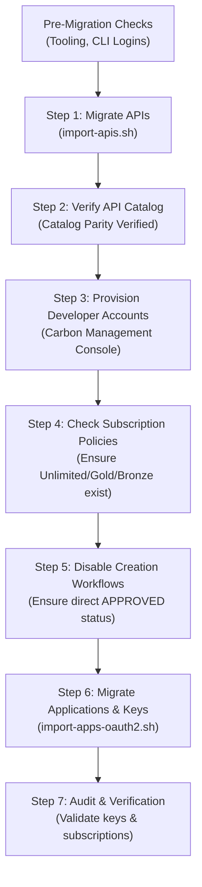

# WSO2 API & Application Management Utilities

A comprehensive toolkit of Bash automation scripts for managing, inspecting, backing up, and migrating APIs and Applications across **WSO2 API Manager** environments.

Specialized for **cross-version** (v4.1.0 → v4.7.0) and **cross-database** (MySQL → PostgreSQL) migrations, decoupling database engines via the WSO2 API Controller CLI (`apictl`) and REST APIs.

---

## Table of Contents
1. [Tool Inventory](#tool-inventory)
2. [Prerequisites & Environment Setup](#prerequisites--environment-setup)
3. [Usage Guide: `import-apis.sh` (API Migration)](#1-import-apissh---api-migration)
4. [Usage Guide: `import-apps-oauth2.sh` (Application & Key Migration)](#2-import-apps-oauth2sh---application--oauth2-key-migration)
5. [Usage Guide: `get_api_security_scheme.sh` & `check-deployed-apis.sh`](#3-get_api_security_schemesh--check-deployed-apissh)
6. [Usage Guide: `backup-api-definitions.sh` & `compare-api-definitions.sh`](#4-backup-api-definitionssh--compare-api-definitionssh)
7. [End-to-End Migration Playbook](#end-to-end-migration-playbook)
8. [Troubleshooting & Known Gotchas](#troubleshooting--known-gotchas)

---

## Tool Inventory

| Script | Primary Function | Protocol / Engine |
| :--- | :--- | :--- |
| [`import-apis.sh`](file:///home/heinhtetzaw346/repos/personal/scripts/Bash/wso2/import-apis.sh) | Migrates API catalogs, lifecycles, revisions, endpoints, and credentials | `apictl41` → `apictl47` |
| [`import-apps-oauth2.sh`](file:///home/heinhtetzaw346/repos/personal/scripts/Bash/wso2/import-apps-oauth2.sh) | Migrates applications, subscriptions, and OAuth2 client credentials | `apictl41` → `apictl47` |
| [`get_api_security_scheme.sh`](file:///home/heinhtetzaw346/repos/personal/scripts/Bash/wso2/get_api_security_scheme.sh) | Extracts authentication schemes and active subscriptions to CSV | Publisher v3 REST API |
| [`check-deployed-apis.sh`](file:///home/heinhtetzaw346/repos/personal/scripts/Bash/wso2/check-deployed-apis.sh) | Audits which gateway environments APIs are actively deployed to | Publisher v3 REST API |
| [`backup-api-definitions.sh`](file:///home/heinhtetzaw346/repos/personal/scripts/Bash/wso2/backup-api-definitions.sh) | Backs up OpenAPI/Swagger specs (`swagger.yaml`) to `./backups` | `apictl` |
| [`compare-api-definitions.sh`](file:///home/heinhtetzaw346/repos/personal/scripts/Bash/wso2/compare-api-definitions.sh) | Compares OpenAPI definitions between environments with semantic diff | `apictl` + `dyff` |

---

## Prerequisites & Environment Setup

### Required Tools
Ensure the following utilities are installed in your `$PATH`:
- `apictl41` (WSO2 API Controller v4.1.x)
- `apictl47` (WSO2 API Controller v4.7.x)
- `python3` (with `pyyaml` package: `pip install pyyaml`)
- `jq`, `unzip`, `zip`, `curl`
- `dyff` (optional, for YAML diff comparisons in `compare-api-definitions.sh`)

### Environment Aliases in `apictl`
Set up and log in to both your source (v4.1) and target (v4.7) environments:

```bash
# Example: Source Environment (WSO2 AM 4.1)
apictl41 add env source-env \
  --apim https://apim-source.example.com \
  --token https://apim-source.example.com/oauth2/token
apictl41 login source-env -u admin -p '<password>' -k

# Example: Target Environment (WSO2 AM 4.7)
apictl47 add env target-env \
  --apim https://apim-target.example.com \
  --token https://apim-target.example.com/oauth2/token
apictl47 login target-env -u admin -p '<password>' -k
```

Verify logged-in environments:
```bash
apictl41 get envs
apictl47 get envs
```

---

## 1. `import-apis.sh` - API Migration

Automates exporting APIs from source (v4.1), transforming metadata for compatibility with v4.7, and importing into the target cluster.

### Built-in Automated Compatibility Fixes
- **Empty Throttling Policy Sanitization**: Converts empty strings (`apiThrottlingPolicy: ""`) to `null` to prevent WSO2 AM 4.7 `400 Bad Request` (`900907`).
- **Role Normalization**: Normalizes legacy or case-mismatched roles (`legacy_developer`, `external_developer`, etc.) to canonical Carbon roles (`Dev_Team_Lead`, `Internal_Developer`, `Internal_Publisher`).
- **WSDL Schema Location Cleanup**: Strips unresolvable local/private `schemaLocation="..."` attributes from WSDL files to prevent import failures.
- **Legacy Registry Path Cleanup**: Cleans obsolete Carbon Registry WSDL URLs (`_system/governance/...`).
- **Empty Additional Properties Cleanup**: Removes empty key/value pairs that fail schema validation in 4.7.
- **Lifecycle & Credential Preservation**: Automatically retains status (`PUBLISHED`, `PROTOTYPED`, `CREATED`) and endpoint auth credentials.

### Command Options

```text
Usage:
  ./import-apis.sh [options]

Environment Options:
  -s, --source-env <env>        Source environment name in apictl41 (e.g. source-env)
  -t, --target-env <env>        Target environment name in apictl47 (e.g. target-env)

Provider Options:
      --preserve-provider       Preserve the original API creator in target (default: true)
  -r, --provider <provider>     Assign all migrated APIs to target provider (sets preserve-provider=false)

Filter Options:
  -a, --api <name>              Migrate only a single API matching exact name
  -v, --version <version>       Specify version when migrating a single API
  -f, --filter <pattern>        Filter APIs whose name matches regex pattern
      --source-provider <name>  Migrate only APIs created by a specific source provider
      --status <status>         Filter by lifecycle status (e.g. PUBLISHED, CREATED)
  -l, --limit <num>             Max APIs to fetch from source (default: 10000)

Execution & Behavior:
      --dry-run                 Simulate migration: lists APIs without modifying target
      --no-update               Do not pass --update to apictl47 (fails if API exists)
      --rotate-revision         Rotate revisions with each update in target cluster
      --skip-deployments        Update working copy only without deploying to gateways
      --no-preserve-status      Do not preserve lifecycle status (imports as CREATED)
      --no-preserve-credentials Do not preserve endpoint security credentials
      --keep-archives           Preserve prepared zip archives in ~/.wso2apictl/exported/apis/ready
      --secure                  Enforce strict SSL certificate verification (default: -k)
  -y, --yes                     Non-interactive confirmation
  -h, --help                    Show help manual
```

### Common Usage Examples

#### 1. Interactive Guided Mode
Prompted menus for environments, filtering, and provider strategy:
```bash
./import-apis.sh
```

#### 2. Full Catalog Batch Migration
Migrate all APIs, preserve original providers, and promote to source lifecycle states:
```bash
./import-apis.sh -s source-env -t target-env -y
```

#### 3. Dry-Run Inspection
Preview the exact list of eligible APIs without executing exports or imports:
```bash
./import-apis.sh -s source-env -t target-env --dry-run
```

#### 4. Migrate a Single API & Version
```bash
./import-apis.sh -s source-env -t target-env -a customer-service -v v1alpha -y
```

#### 5. Migrate by Name Regex Pattern or Lifecycle Status
```bash
# Migrate all core APIs that are currently PUBLISHED
./import-apis.sh -s source-env -t target-env --filter "^core-" --status PUBLISHED -y
```

#### 6. Reassign Provider to Admin
```bash
./import-apis.sh -s source-env -t target-env -r admin -y
```

### Output & Audit
Every run produces an audit CSV in `Bash/wso2/out/` and `.agent-files/out/`:
`wso2_api_migration_<source>_to_<target>_<timestamp>.csv`
Recording: `Index, API Name, Version, Source Provider, Target Provider, Lifecycle Status, Status, Message`.

---

## 2. `import-apps-oauth2.sh` - Application & OAuth2 Key Migration

Automates exporting applications and their OAuth2 client credentials (Production & Sandbox keys) from source (v4.1) and importing them cleanly into target (v4.7).

### Key Features
- **Key Registration Enforcement**: Modifies `application_meta.yaml` to force `skipKeys: false` and `update: true`, ensuring resident Key Manager / DCR creates the OAuth service providers.
- **Ownership Strategy**: Supports `--preserve-owner` (preserves original user account) or `-o <target-owner>` (reassigns applications to a designated service account such as `admin`).
- **Case-Insensitive Collision Protection**: Detects and resolves case differences (e.g. `Default Application` vs `DefaultApplication`) enforced strictly in 4.7.
- **Workflow Decoupling**: Imports applications directly into `APPROVED` status when approval workflows are bypassed or disabled.

### Command Options

```text
Usage:
  ./import-apps-oauth2.sh [options]

Environment Options:
  -s, --source-env <env>        Source environment name in apictl41 (e.g. source-env)
  -t, --target-env <env>        Target environment name in apictl47 (e.g. target-env)

Owner Options:
  -o, --owner <owner>           Target owner for imported applications (default: "admin")
      --preserve-owner          Preserve the original application owner in target cluster
                                (Requires developer account in target user store)

Filter Options:
  -a, --app <name>              Migrate only a single application matching exact name
  -f, --filter <pattern>        Filter applications whose name matches regex pattern
      --source-owner <owner>    Migrate only applications owned by a specific source user
  -l, --limit <num>             Max applications to retrieve from source (default: 10000)
      --skip-default-app        Skip "DefaultApplication" (default: true)
      --include-default-app     Include "DefaultApplication" in migration

Execution & Behavior:
      --dry-run                 Simulate migration: list apps without exporting/importing
      --skip-subscriptions      Skip application subscriptions during target import
      --no-update               Do not pass --update to apictl47 import
      --keep-archives           Preserve prepared ready zip archives after import
      --secure                  Enforce strict SSL verification (default: -k)
  -y, --yes                     Non-interactive confirmation
  -h, --help                    Show help manual
```

### Common Usage Examples

#### 1. Interactive Guided Mode
```bash
./import-apps-oauth2.sh
```

#### 2. Batch Migration Reassigning to `admin`
Recommended when developer accounts have not yet been provisioned in the target user store:
```bash
./import-apps-oauth2.sh -s source-env -t target-env -o admin -y
```

#### 3. Batch Migration Preserving Original Owners
*(Requires that owners exist in Carbon User Store)*:
```bash
./import-apps-oauth2.sh -s source-env -t target-env --preserve-owner -y
```

#### 4. Phased Migration by Source User
Migrate only applications belonging to a specific developer:
```bash
./import-apps-oauth2.sh -s source-env -t target-env --source-owner developer1 --preserve-owner -y
```

#### 5. Migrate a Single Application
```bash
./import-apps-oauth2.sh -s source-env -t target-env -a "PaymentServiceApp" --preserve-owner -y
```

#### 6. Migrate Applications Without Subscriptions
Imports the application and its OAuth client credentials, bypassing subscription attachment:
```bash
./import-apps-oauth2.sh -s source-env -t target-env --skip-subscriptions -o admin -y
```

### Output & Audit
Produces an audit CSV in `Bash/wso2/out/` and `.agent-files/out/`:
`wso2_app_migration_<source>_to_<target>_<timestamp>.csv`
Recording: `Index, Application Name, Source Owner, Target Owner, Status, Message`.

---

## 3. `get_api_security_scheme.sh` & `check-deployed-apis.sh`

These utilities query the WSO2 Publisher v3 REST APIs directly to audit deployed security schemes and gateway deployments.

### Authentication via `.env.tokens`
To authenticate, obtain your active browser session tokens from the WSO2 Publisher portal (Inspect Network tab):
- `AM_ACC_TOKEN_DEFAULT_P2` (Cookie)
- `WSO2_AM_TOKEN_1_Default` (Bearer Token)

Create a `.env.tokens` file in `Bash/wso2/`:
```bash
AM_ACC_TOKEN_DEFAULT_P2="12345678-abcd-ef01-2345-6789abcdef01"
WSO2_AM_TOKEN_1_Default="abcdef01-2345-6789-abcd-ef0123456789"
APIM_BASE_URL="https://apim-source.example.com"
```

### Running the Scripts

```bash
# 1. Audit API Security Schemes & Subscriptions
./get_api_security_scheme.sh
# Generates: api_security_schemes.csv

# 2. Audit Gateway Deployment Status
./check-deployed-apis.sh
# Generates: deployed_apis.csv
```

---

## 4. `backup-api-definitions.sh` & `compare-api-definitions.sh`

### Backing Up Swagger/OpenAPI Definitions
Downloads the active OpenAPI definition (`swagger.yaml`) of an API via `apictl`:
```bash
./backup-api-definitions.sh
# Prompts for Environment, API Name, and Version
# Saves to: ./backups/<env>_<api>_<version>_swagger.yaml
```

### Semantic Comparison Across Environments
Compares OpenAPI definitions between two environments (or two versions) to detect schema drift:
```bash
# Interactive mode:
./compare-api-definitions.sh

# Non-interactive CLI mode:
./compare-api-definitions.sh --non-interactive \
  source-env payment-service v1alpha \
  target-env payment-service v1alpha \
  --output ./diff_payment_service.txt
```

---

## End-to-End Migration Playbook

Follow this procedural sequence when executing an environment migration:



### Phase 1: APIs First
APIs **must** exist in the target cluster before applications can be attached to them:
```bash
./import-apis.sh -s source-env -t target-env -y
```
Verify all APIs are published:
```bash
apictl47 get apis -e target-env -k -l 100
```

### Phase 2: User Provisioning (If Preserving Owners)
If running `--preserve-owner`, create the application owners in the target Carbon Console:
- Log in to `https://<control-plane-url>/carbon/`
- Navigate to **Users and Roles** → **Users** → **Add New User**
- Assign required roles (e.g., `Internal/devportal-user`, `Internal/subscriber`).

### Phase 3: Subscription Tier Alignment
Ensure that target APIs offer the subscription tiers that applications will request (e.g., `Unlimited`, `Gold`, `Bronze`). If an API restricts subscription tiers, update its business plans in Publisher before importing applications.

### Phase 4: Applications & OAuth2 Keys
Migrate applications with keys and subscriptions:
```bash
./import-apps-oauth2.sh -s source-env -t target-env --preserve-owner -y
```

---

## Troubleshooting & Known Gotchas

### 1. `DCRMException: Error while creating service provider` (HTTP 500)
- **Symptom**: Application import fails with HTTP 500. Control plane logs show:
  `Caused by: IdentityApplicationManagementException: Error resolving service provider owner.`
- **Cause**: The application has OAuth client credentials, triggering Dynamic Client Registration (DCR). The owner does not exist in the Carbon User Store.
- **Fix**:
  1. Add the user account in Carbon Console (`https://<cp-url>/carbon/`), **OR**
  2. Reassign the application to an existing user/admin using `-o admin`.

### 2. `207 Multi-Status: Subscribed APIs missing in target cluster`
- **Symptom**: Application import reports 207 Multi-Status. Control plane logs show:
  `WARN ImportUtils - Tier:Unlimited is not available for API <api-name>-<version>`
- **Cause**: The application in the source cluster holds a subscription to a tier (e.g. `Unlimited`) that is not enabled in the target API's `policies`.
- **Fix**:
  1. Open the API in Publisher Portal (`https://<cp-url>/publisher`) → **Subscriptions** / **Business Plans**.
  2. Enable the requested tier (e.g. check **Unlimited**).
  3. Deploy a new revision and re-run the application import.

### 3. `GovernanceException: Governance artifact ... already exists` (HTTP 500)
- **Symptom**: `import-apis.sh` fails on specific APIs with HTTP 500 after a purge. Control plane logs show:
  `Governance artifact already exists at /apimgt/applicationdata/provider/<user>/<api>/<version>/api`
- **Cause**: The API row was removed from the relational DB (`AM_API`), but an orphaned registry node or in-memory artifact cache remained in the Governance Registry (`REG_RESOURCE`).
- **Fix**:
  1. Allow a few minutes for cache eviction, then re-run with `--update`:
     ```bash
     ./import-apis.sh -s source-env -t target-env -a <api-name> -v <version> -y
     ```

### 4. `400 Bad Request: apiThrottlingPolicy must not be empty`
- **Symptom**: WSO2 AM 4.7 rejects exported 4.1 APIs.
- **Cause**: In v4.1, unthrottled APIs wrote `apiThrottlingPolicy: ""` (empty string), whereas v4.7 schema validation enforces non-empty or `null`.
- **Fix**: Automatically sanitized by `import-apis.sh` during the metadata transformation phase.

### 5. `400 Bad Request: WSDL schemaLocation unreachable`
- **Symptom**: SOAP/WSDL APIs fail import due to unresolvable external XSD links.
- **Fix**: Automatically sanitized by `import-apis.sh` by stripping local/unresolvable `schemaLocation` attributes from `.wsdl` files prior to repacking.
